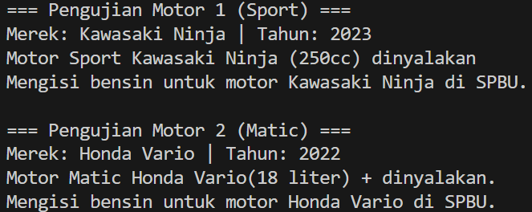

# Java OOP Assignment: Motorcycle System (Abstract Class & Interface)

---

## 1. Project Overview
This project is an Object-Oriented Programming (OOP) assignment in Java demonstrating the core concepts of **Abstract Classes** and **Interfaces**
* **Abstract Class (`Kendaraan`)**: Serves as the base parent class for all vehicles, defining common attributes (`merek`, `tahun`) and requiring subclasses to implement abstract behaviors.
* **Interface (`IsiBensin`)**: Acts as a contract specifying refueling capability (`isiBahanBakar()`).
* **Inheritance & Polymorphism**: Demonstrates class hierarchy (`Kendaraan` $\rightarrow$ `Motor` $\rightarrow$ `MotorSport` / `MotorMatic`) and runtime polymorphism through method overriding (`menyalakanMesin()`).

---

## 2. Classes and Interfaces Overview

### a. `Kendaraan.java` (Abstract Class)
Serves as the abstract base class for all vehicle types.
* **Attributes:**
  * `protected String merek`: Brand of the vehicle.
  * `protected int tahun`: Production year of the vehicle.
* **Methods:**
  * `Kendaraan(String merek, int tahun)`: Constructor initializing the brand and production year.
  * `void infoKendaraan()`: Concrete method displaying basic vehicle information.
  * `abstract void menyalakanMesin()`: Abstract method enforcing custom engine startup implementations in subclasses.

---

### b. `IsiBensin.java` (Interface)
Defines the functional contract for vehicles capable of refueling.
* **Methods:**
  * `void isiBahanBakar()`: Implicitly public and abstract method requiring implementation to define refueling behavior.

---

### c. `Motor.java`
Represents a motorcycle class that extends `Kendaraan` and implements `IsiBensin`.
* **Attributes:**
  * `private String jenisMotor`: Motorcycle category type.
* **Methods:**
  * `Motor(String merek, int tahun, String jenisMotor)`: Constructor initializing inherited and specific fields using `super()`.
  * `void menyalakanMesin()`: Provides default implementation for starting the motorcycle engine.
  * `void isiBahanBakar()`: Implements the refueling interface method.
  * `String getJenisMotor()`: Getter for retrieving the motorcycle type.

---

### d. `MotorSport.java`
A specific subclass of `Motor` representing sport motorcycles.
* **Attributes:**
  * `private int kapasitasMesin`: Engine displacement capacity in cubic centimeters (cc).
* **Methods:**
  * `MotorSport(String merek, int tahun, int kapasitasMesin)`: Constructor initializing sport motorcycle parameters.
  * `@Override void menyalakanMesin()`: Overrides engine startup behavior with a loud exhaust sound.

---

### e. `MotorMatic.java`
A specific subclass of `Motor` representing automatic motorcycles.
* **Attributes:**
  * `private int kapasitasBagasi`: Under-seat luggage storage capacity in liters.
* **Methods:**
  * `MotorMatic(String merek, int tahun, int kapasitasBagasi)`: Constructor initializing automatic motorcycle parameters.
  * `@Override void menyalakanMesin()`: Overrides engine startup behavior with an electric starter sound.

---

### f. `Main.java`
The main execution driver class demonstrating:
* Instantiating polymorphic objects (`MotorSport` and `MotorMatic`) using superclass references (`Motor`).
* Demonstrating runtime polymorphism when invoking overridden methods (`menyalakanMesin()`).
* Executing implemented interface behaviors (`isiBahanBakar()`).

---

## 3. Class Diagram

### Class Diagram

## 4. Output Screenshot

### Output Execution
